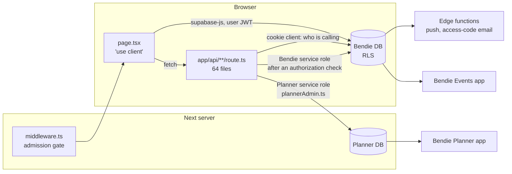

# 04 — Technical Architecture

**Status:** VERIFIED from source, `package.json` and the live projects. Builds on [context/architecture.md](../../context/architecture.md); the differences from it are listed at the end.

## Stack

| Layer | In use | Installed but unused |
|---|---|---|
| Framework | Next.js **15.5** App Router, React **19** | — |
| Language | TypeScript | — |
| Data | Supabase (Postgres, Auth, Storage, Edge Functions), `@supabase/ssr` 0.5.2 | — |
| Styling | Tailwind 3 with Material-style tokens (`tailwind.config.js`, `globals.css`), Plus Jakarta Sans, Material Symbols | `react-color` |
| State | React Context ×7 (Auth, Organization, Product, AvailableProducts, Event, Confirm, CreateEvent) | `zustand` |
| Forms | `useState` + direct Supabase calls | `react-hook-form`, `zod`/`@hookform/resolvers` |
| Import | `papaparse`, `exceljs` (lazy) via `CsvImportModal` | — |
| Drag and drop | — | `@dnd-kit/*` |
| Feedback | `react-hot-toast` | — |
| Tests | `vitest`: 4 test files, pure helpers only. No component, end-to-end or Playwright tests. | — |
| AI | **None** | — |

## Shape of the code

- **Pages fetch their own data.** Bendie content pages (24) call Supabase directly from the browser under RLS. There's no service or repository layer [V].
- **Server routes are used only where needed:** service-role work (user provisioning, contacts, gallery and moderation, organisation admin) and **every** Planner read and write [V].
- **The `src/lib` domain modules are the real service layer for Planner:** `plannerTasks.ts`, `plannerLogistics.ts`, `plannerProduction.ts` and so on, plus `plannerModuleAccess.ts` and `plannerAccessRules*.ts` for authorization. These are what an AI action registry should call (doc 27).
- **Large client pages:** agenda 1,267 lines, planner-logistics 1,211, the event layout 1,098, members 644, planner-people 644, dashboard 614.
- **Event layout cost:** on every event navigation it resolves product availability and six Planner module capabilities. Feature 016 merged these into one request.

## Background processes [V]

| Process | Where | Trigger |
|---|---|---|
| Scheduled push | `trigger_process_due_push_notification` → `send-notification-push` edge function | `event_push_notifications.scheduled_at` |
| Engagement reminders | `enqueue_engagement_notifications` → `engagement_notification_log` | Database side; no UI |
| Access-code email | `auto_issue_event_access_code_on_member_insert` → `send-event-access-code-email` | New `event_members` row |
| Audit | `log_content_change`, `log_event_change`, `log_org_content_change` and others | Triggers on content tables |
| Breakout JSON rebuild | `rebuild_breakout_rooms_json` | Breakout table writes |
| Org admin auto-membership | `add_org_admins_to_new_event`, `add_new_org_admin_to_events`, `remove_former_org_admin_from_events` | Triggers |
| Planner push | `push-dispatch` (Planner project) | Planner side |
| Planner provisioning | `plannerEventProvisioning.ts` called from `/api/events/create`, with a retry route | After the create RPC; failures recorded on `events.planner_provisioning_*` |

There is no job queue, so long imports run in the browser.

## Storage [V]

Buckets: `event-assets` (public read, admin write), `org-assets` (through `assetUpload.ts`), `event-files` (Files tab). The app also uses `avatars`, `post-images` and `chat-media`.

## Environment variables (names only)

Read by code: `NEXT_PUBLIC_SUPABASE_URL`, `NEXT_PUBLIC_SUPABASE_ANON_KEY`, `SUPABASE_SERVICE_ROLE_KEY`, `PLANNER_SUPABASE_URL`, `PLANNER_SUPABASE_SERVICE_ROLE_KEY`. Listed in `.env.example` but never read by code: `NEXT_PUBLIC_APP_NAME`, `NEXT_PUBLIC_APP_VERSION`, `NEXT_PUBLIC_SENTRY_DSN`, `NEXT_PUBLIC_ANALYTICS_ID`. So Sentry and analytics are not wired, and there's no baseline telemetry for doc 38. No AI keys exist yet; doc 25 proposes `QWEN_*`.

## Differences from `context/architecture.md`

1. It says Next 14; the app is on Next 15.5 with React 19.
2. "gated to `global_role = 'admin'`" is no longer true: any organisation member is admitted.
3. "16 content sections / 21 tabs": there are 32 event sections.
4. "two `api/admin/*` routes": there are 64 API route files.
5. "No component tests" is still true, with 4 helper test files.

## Implications for the revamp (verified findings, not proposals)

- **Reuse is uneven.** The Planner side has domain modules an AI layer can reuse. The Bendie side doesn't: its business logic sits in page components, so AI actions for Bendie content would need those writes pulled into shared modules first. That rule follows from Portal 2.0 rule 9 and AGENTS.md (no duplicate business logic).
- **Large pages are a risk** for any redesign of agenda, logistics and the event layout.
- **No browser tests.** Parity testing (doc 16) has nothing automated to build on.
