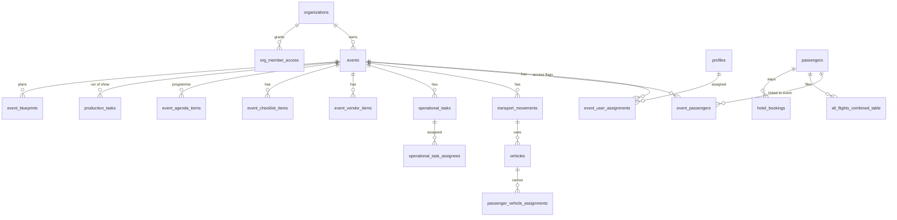

# 07 — Database Schema

**Status:** VERIFIED against both live projects on 2026-11-19 with read-only catalog queries. No data was changed. The machine-readable version is [data/entities.json](data/entities.json). Bendie field-level detail is in [context/schema-reference.md](../../context/schema-reference.md) and isn't repeated here.

## Two databases

| | Bendie project | Bendie Planner project |
|---|---|---|
| Tables (`public`) | 63, all with RLS (3 have no policies: `engagement_notification_log`, `event_creation_requests`, `meeting_requests`) | 40, all with RLS (**16 have no policies**, so they're service-role only, including `transport_movements` and the realtime session tables) |
| IDs | uuid | integer/bigint; `profiles.id` is uuid |
| Auth realm | Bendie Events, Studio | Bendie Planner (separate) |
| Studio access | Browser client under RLS, plus server routes | **Server routes only**, using the Planner service role |
| Functions | ~100 (most `SECURITY DEFINER`) | not inventoried |
| Edge functions | 6 | 1 (`push-dispatch`) |

## Bendie entity relationships (core)

```mermaid
erDiagram
  organizations ||--o{ organization_members : has
  organizations ||--o{ organization_products : entitles
  organizations ||--o{ teams : has
  teams ||--o{ team_members : has
  organizations ||--o{ organization_assets : stores
  organizations ||--o{ events : owns
  profiles ||--o{ organization_members : is
  profiles ||--o{ event_members : is
  events ||--o{ event_products : enables
  events ||--o{ event_members : has
  event_members ||--o{ event_user_access_codes : "issued"
  events ||--o| event_planner_links : "links to Planner event"
  events ||--o{ facilitators : has
  events ||--o{ agenda_sessions : has
  agenda_sessions ||--o{ agenda_session_speakers : has
  facilitators ||--o{ agenda_session_speakers : speaks
  agenda_sessions ||--o{ agenda_breakout_rooms : splits
  agenda_breakout_rooms ||--o{ agenda_breakout_room_items : contains
  agenda_breakout_rooms ||--o{ agenda_breakout_assignments : places
  event_members ||--o{ agenda_breakout_assignments : placed
  events ||--o{ attendee_travel_details : has
  events ||--o{ event_interest_options : asks
  events ||--o{ news_items : "has (or global)"
  events ||--o{ expo_spaces : "has (or global)"
  excursion_categories ||--o{ excursions : groups
  events ||--o{ faqs : has
  events ||--o{ support_contacts : has
  events ||--o{ emergency_contacts : has
  events ||--o{ games : has
  games ||--o{ game_questions : has
  events ||--o{ event_push_notifications : sends
  events ||--o{ posts : gallery
  events ||--o{ event_content_audit_log : audits
```

## Planner entity relationships (core)

## Cross-database links (not foreign keys)

| Bendie column | Planner target | How it's kept in sync |
|---|---|---|
| `event_planner_links.planner_event_id` | `events.event_id` | Link at provisioning or by hand; one active link per event |
| `organization_planner_links` | `organizations.organization_id` | Stawi admin connects (Feature 022) |
| `profiles.planner_profile_id` | `profiles.id` | Resolved or created **by email** |
| `event_members.planner_assignment_id` | `event_user_assignments.assignment_id` | Staff sync and permissions routes |
| `agenda_sessions.planner_agenda_item_id` | `event_agenda_items.agenda_item_id` (with `source_portal_session_id` back) | Manual "Push to Planner" |
| `attendee_travel_details.source_planner_key` | flights and hotels | Manual "Pull from Planner" |

## Schema observations [V]

1. **Planner legacy and one-off tables:** `capetown` (74 rows), `johburg_one` (164), `johburg_two` (0), `slt_vip` (10), `staging_production_csv`, `shuttles`, `transport_logistics`, `users`, `vehicle_passengers`, `planner_access_backup_022`. Most have no policies. They look like earlier per-event imports. Don't build on them; confirm ownership with the Planner team (doc 40).
2. **The Planner flights table is named `all_flights_combined_table`.** It keeps `departuretime`/`arrivaltime` text next to typed `depart_time`/`arrive_time`, plus `source_table`. That's legacy consolidation.
3. **Planner `operational_tasks.status` is free text** (`Pending` / `In progress` / `Completed`) alongside the booleans `pending`, `active` and `completed`.
4. **Mixed date and time types in Planner:** `timestamp without time zone` plus a separate `date` and `time`, with `events.timezone` for interpretation. Bendie uses `timestamptz` with `events.timezone` (Feature 024).
5. **Bendie `attendee_travel_details` stores dates and times as text.**
6. **`agenda_sessions.breakout_rooms` (jsonb) is derived.** A trigger rebuilds it and a guard refuses direct writes.
7. **Global rows:** `news_items`, `expo_spaces`, `excursions` and `excursion_categories` allow `event_id IS NULL` to mean "every event".
8. **`event_members.onboarding_status`** is written by the app, not Studio. 385 of 632 are `pending`.

No schema was modified (Portal 2.0 rule 5).
