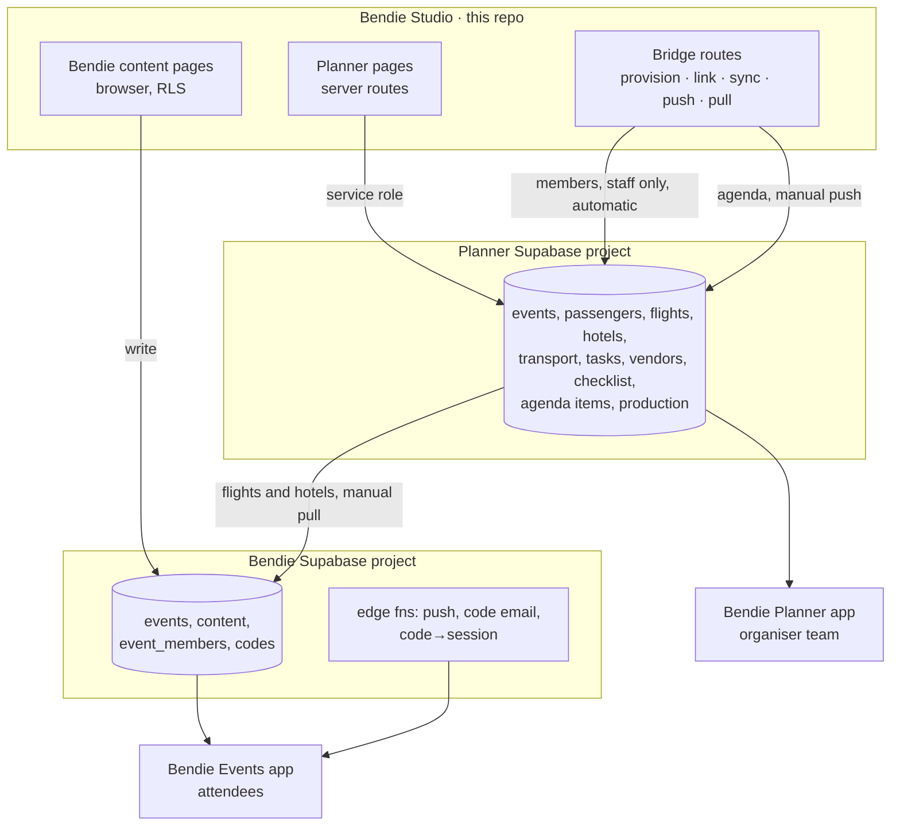

# 09 — Product Relationships

**Labels:** [V] verified in source or the live database · [M] verified in the mobile app code (`data/mobile/studio-contract-*.json`, file:line evidence inside) · [D] documented, not re-verified.

**Update 2026-11-20:** both app codebases were audited by an agent using `prompts/mobile-app-extraction.md`: Bendie Events @ `b64159b` (Expo 58 / React Native 0.88 / React 19) and Bendie Planner @ `0eeaac4` (Expo 58). The findings are in the section "What the apps actually do" below and in `data/entities.json` (`mobile_app` per table).

## Who owns which data

| Data | Created in | Source of truth | Read by | Flow |
|---|---|---|---|---|
| Organisation | Studio (Stawi admins, or sign-up) | Bendie `organizations`; Planner `organizations` is linked separately | Studio, Events app | Bendie ↔ Planner organisation link (Feature 022) |
| Product entitlement | Studio admin | `organization_products`, `event_products` | Studio; Planner `organizations.is_active` mirrors a pause | Studio → Planner (pause/resume) [V] |
| Event identity (name, dates, location, timezone) | Studio create | Bendie `events` | Both apps | Copied to Planner **once** at provisioning. Later Basics edits are **not** pushed [V: Feature 024 notes "a copy once"] |
| Attendee content (branding, agenda, speakers, FAQ, news, expo, info, emergency, games, files, photos) | Studio | Bendie tables | Events app | Live on save [V]. App: home data cached in memory for **5 min**; agenda and notifications refetch on focus; theme reloads only at sign-in, launch or event switch [M] |
| Attendees and access codes | Studio, CSV, app self-join (`join_event_by_slug`) | `event_members`, `event_user_access_codes` | Events app | Code emailed by an edge function on insert [V] |
| Networking answers, chats, posts, ratings, points | Events app | Bendie runtime tables | Events app; Studio moderates | — |
| Programme (Planner) | Studio Planner agenda, Planner app, or push from Bendie agenda | Planner `event_agenda_items` | Planner app | Bendie → Planner, manual, one way [V] |
| Run-of-show | Studio or Planner app | Planner `production_tasks` | Planner app | Planner only. Never shown to attendees [V] |
| Participants, flights, hotels, transport | Studio Planner pages, CSV, Planner app | Planner tables | Planner app | Flights and hotels can be pulled into Bendie `attendee_travel_details` (manual, read-only copy) [V] |
| Planner staff access | Studio (Team & Access) or Planner | Planner `event_user_assignments` | Planner app, Studio | Studio → Planner. Staff-tier event roles sync automatically [V] |
| Tasks, vendors, checklist | Studio or Planner app | Planner tables | Planner app | Planner only |
| Push to attendees | Studio Notifications | `event_push_notifications` | Events app (push) | Scheduled by trigger [V] |

## What happens when you change something in Studio

| Change | Bendie Events app | Bendie Planner app |
|---|---|---|
| Edit content on any Bendie tab | Visible to members straight away. There is no draft or publish step for content [V] | — |
| Set `events.status` to `active` or `published` | Event becomes publicly readable through `events_select_public_showcase` (anon and authenticated). The "Contact organizer" contact is returned only for these statuses [V] | — |
| Set status to `draft` | Members still see the event (member policies). Engagement reminders **still** run for draft events [V] | — |
| Change Basics dates, name or timezone | Visible straight away | **Not propagated** after creation [V] |
| Add an attendee | Access code issued and emailed [V] | A staff-tier role (host, organizer, admin, staff) is synced to Planner [V] |
| Edit the Bendie agenda | Visible straight away | Only after a manual "Push to Planner" |
| Edit Planner flights or hotels | Only after a manual "Pull from Planner" into attendee travel | Visible straight away |
| Pause a product | Studio tabs show the paused notice. **The Events app ignores it:** it never reads `event_products`/`organization_products` [M] | Planner `is_active` off: people lose Planner access, Planner platform admins keep it [V] |

## Which product each setting affects

| Affects | Settings |
|---|---|
| Bendie Events only | Hero, theme, terminology and menu (`disabled_menu_items`), speakers, agenda (Bendie), activities, excursions, attendee travel, networking, news, FAQs, info center, expo, gallery, event photos, files, emergency, games, notifications |
| Bendie Planner only | Participants, tasks, vendors, checklist, logistics, Planner agenda, production, Planner permissions |
| Both | Event identity (once), staff members, agenda (push), travel (pull), product pause |
| Studio only | Teams, assets (until used in content), Manage modules (`portal_setup_modules` only drives the Dashboard), activity logs, Organisations admin |

## Identity bridging risk [V]

There's no shared user ID. A person is matched across projects by **lower-cased email**. In the live data **353 of 409 Planner passengers (86%) have no email**. Pulled travel and the "Bendie Attendee" badge therefore can't match most participants. Any "one person across products" design (docs 17, 28) has to deal with this first.

## What the apps actually do [M] (2026-11-20)

| Topic | Bendie Events app | Bendie Planner app |
|---|---|---|
| `events.status` | Public showcase, scanner and landing show only `active`/`published`; `draft` is hidden from public lists; the member event picker lists **all** statuses; in-event screens don't check status | **Never read.** Draft or archived Studio events stay visible to assigned users |
| Products (`event_products`, `organization_products`) | Not read, so **pausing has no effect in the app** | Not read (Planner access is cut only through Planner's own `is_active`, Feature 022) |
| `disabled_menu_items` | Hides menu items: `excursions, expo, news, interactives, event_photos, files, feedback, info`. Networking is controlled by `networking_mode` | Not read (fixed tabs; modules from assignment switches) |
| Terminology | `category_label`, `theme_label`, `theme_icon` shown on home. **`facilitator_label_singular/plural` are fetched but never displayed** | Not read |
| `portal_setup_modules` | Not read (Studio-only, as assumed) | Not read |
| Agenda speakers | **`agenda_session_speakers`** (through the `agenda_sessions_summary` view); `facilitator_id` only as a fallback when the view errors | Free text `event_agenda_items.speakers` / `.mc` |
| Breakouts | **Only** the derived `agenda_sessions.breakout_rooms` JSON; the room choice is in memory only | Inferred from `event_agenda_items` (same `start_time`, `is_parallel`, `track_name`/`room_name`) |
| Time zone | **Hard-coded `Africa/Nairobi`** for agenda and speaker times; `events.timezone` is never read | Venue wall-clock in `events.timezone`, shown on the viewer's clock through `*_utc` view columns |
| Global rows (`event_id IS NULL`) | `news_items`, `excursions`, `excursion_categories`, `expo_spaces`, **`info_content`** are shown in **every** event | — |
| Scheduling | `news_items.published_at` is only used for ordering, so **future-dated news shows immediately** | — |
| Caching | No query cache. Home RPC 5 min; theme only at sign-in/launch/switch; offline outbox for chat, connections and gallery | No cache; realtime on many tables; polling 5–60 s; **offline outbox replays writes later** |
| App version gate | `app_release_config` checked at launch and on every return to the foreground (fails open) | Not read |
| Profiles | Own row via `get_my_profile`; other people's contacts only via `get_profile_contact`/`get_event_member_contacts`. **`agenda_sessions_summary` exposes speaker `email`** in its JSON | Reads its own `first_name, full_name, email, role, gender` **directly** (Planner DB); also other users' `email, role, is_platform_admin, member_type` |
| Writes that overlap Studio | `event_members.onboarding_status` (must reach `completed`), `profiles`, `networking_preferences`, `session_attendees`, posts and photos | `events` (creates and overwrites rows), `event_user_assignments` (**whole-row upserts reset every switch, `org_default` becomes `manual`**), checklist, vendor, production, flights (with offline replay) |
