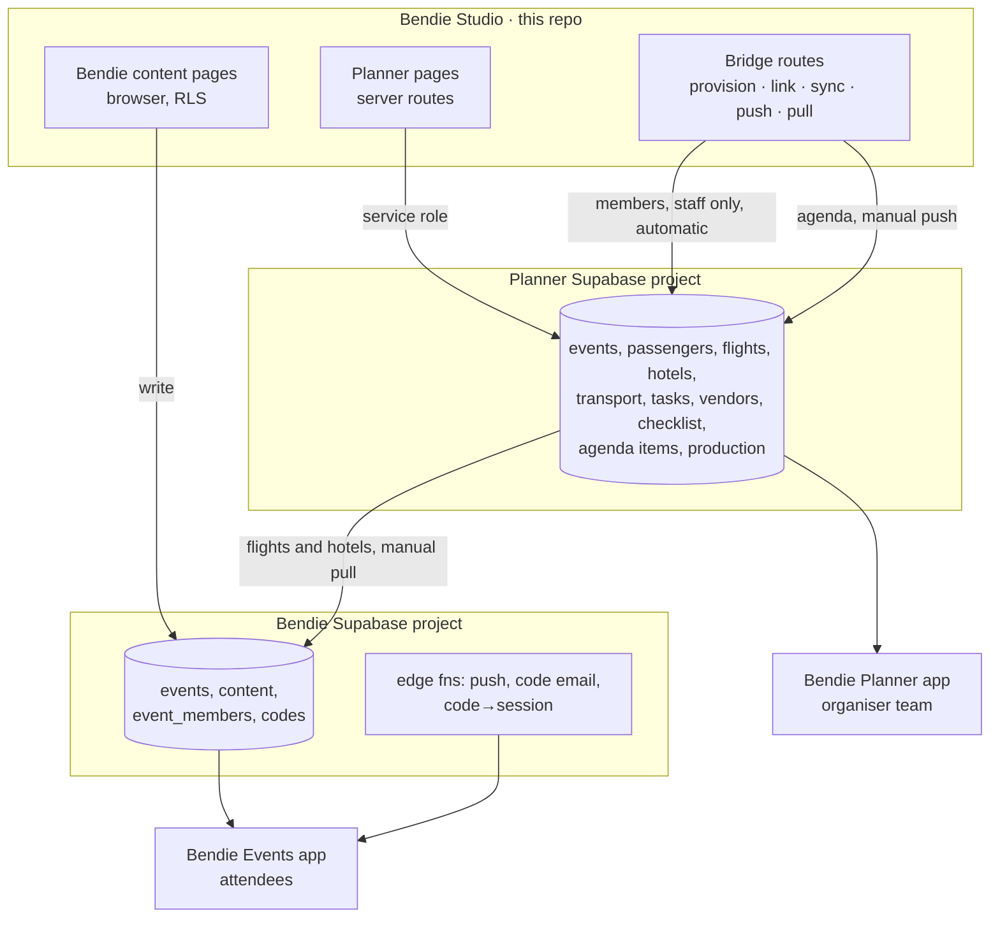

# 09 — Product Relationships

**Labels:** [V] verified in source or the live database · [D] documented, not re-verified · [U] unknown (needs the mobile codebases).

The Bendie Events and Bendie Planner mobile codebases were **not available** for this audit. Anything about how an app reads or caches data is [U] unless the database shows it.

## Who owns which data

| Data | Created in | Source of truth | Read by | Flow |
|---|---|---|---|---|
| Organisation | Studio (Stawi admins, or sign-up) | Bendie `organizations`; Planner `organizations` is linked separately | Studio, Events app | Bendie ↔ Planner organisation link (Feature 022) |
| Product entitlement | Studio admin | `organization_products`, `event_products` | Studio; Planner `organizations.is_active` mirrors a pause | Studio → Planner (pause/resume) [V] |
| Event identity (name, dates, location, timezone) | Studio create | Bendie `events` | Both apps | Copied to Planner **once** at provisioning. Later Basics edits are **not** pushed [V: Feature 024 notes "a copy once"] |
| Attendee content (branding, agenda, speakers, FAQ, news, expo, info, emergency, games, files, photos) | Studio | Bendie tables | Events app | Live on save [V]. App caching [U] |
| Attendees and access codes | Studio, CSV, app self-join (`join_event_by_slug`) | `event_members`, `event_user_access_codes` | Events app | Code emailed by an edge function on insert [V] |
| Networking answers, chats, posts, ratings, points | Events app | Bendie runtime tables | Events app; Studio moderates | — |
| Programme (Planner) | Studio Planner agenda, Planner app, or push from Bendie agenda | Planner `event_agenda_items` | Planner app | Bendie → Planner, manual, one way [V] |
| Run-of-show | Studio or Planner app | Planner `production_tasks` | Planner app | Planner only. Never shown to attendees [V] |
| Participants, flights, hotels, transport | Studio Planner pages, CSV, Planner app | Planner tables | Planner app | Flights and hotels can be pulled into Bendie `attendee_travel_details` (manual, read-only copy) [V] |
| Planner staff access | Studio (Team & Access) or Planner | Planner `event_user_assignments` | Planner app, Studio | Studio → Planner. Staff-tier event roles sync automatically [V] |
| Tasks, vendors, checklist | Studio or Planner app | Planner tables | Planner app | Planner only |
| Push to attendees | Studio Notifications | `event_push_notifications` | Events app (push) | Scheduled by trigger [V] |

## What happens when you change something in Studio

| Change | Bendie Events app | Bendie Planner app |
|---|---|---|
| Edit content on any Bendie tab | Visible to members straight away. There is no draft or publish step for content [V] | — |
| Set `events.status` to `active` or `published` | Event becomes publicly readable through `events_select_public_showcase` (anon and authenticated). The "Contact organizer" contact is returned only for these statuses [V] | — |
| Set status to `draft` | Members still see the event (member policies). Engagement reminders **still** run for draft events [V] | — |
| Change Basics dates, name or timezone | Visible straight away | **Not propagated** after creation [V] |
| Add an attendee | Access code issued and emailed [V] | A staff-tier role (host, organizer, admin, staff) is synced to Planner [V] |
| Edit the Bendie agenda | Visible straight away | Only after a manual "Push to Planner" |
| Edit Planner flights or hotels | Only after a manual "Pull from Planner" into attendee travel | Visible straight away |
| Pause a product | Studio tabs show the paused notice. App effect [U] | Planner `is_active` off: people lose Planner access, Planner platform admins keep it [V] |

## Which product each setting affects

| Affects | Settings |
|---|---|
| Bendie Events only | Hero, theme, terminology and menu (`disabled_menu_items`), speakers, agenda (Bendie), activities, excursions, attendee travel, networking, news, FAQs, info center, expo, gallery, event photos, files, emergency, games, notifications |
| Bendie Planner only | Participants, tasks, vendors, checklist, logistics, Planner agenda, production, Planner permissions |
| Both | Event identity (once), staff members, agenda (push), travel (pull), product pause |
| Studio only | Teams, assets (until used in content), Manage modules (`portal_setup_modules` only drives the Dashboard), activity logs, Organisations admin |

## Identity bridging risk [V]

There's no shared user ID. A person is matched across projects by **lower-cased email**. In the live data **353 of 409 Planner passengers (86%) have no email**. Pulled travel and the "Bendie Attendee" badge therefore can't match most participants. Any "one person across products" design (docs 17, 28) has to deal with this first.
