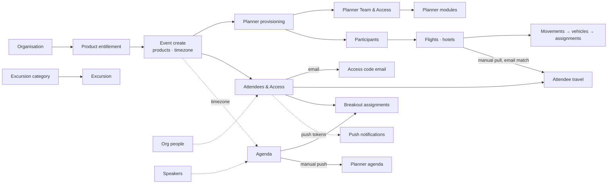

# 11 — Feature Dependencies

**Status:** VERIFIED from constraints, foreign keys, routes and readiness code. Machine-readable version: [data/feature-dependencies.json](data/feature-dependencies.json).

Solid lines are mandatory; dotted lines are soft (it works but is empty or misleading).

## Mandatory

| Feature | Needs | Why |
|---|---|---|
| Create event | An active product for the organisation | Otherwise `/portal/no-product` |
| Any Planner tab | Provisioning succeeded | Tabs wait on the provisioning phase |
| Planner tabs (non-admins) | A Planner identity plus the view flag | `moduleAccess` |
| Flights, hotels, vehicle assignments | A participant | Foreign key to `passengers` |
| Attendee travel | An event member | Per `user_id` |
| Breakout assignments | Event members | Foreign key to `event_members` |
| Excursion | A category | `category_id NOT NULL` |
| Access code delivery | An email on the profile | The code is emailed |
| Travel pull, "Bendie attendee" badge | The same email on both sides | Email join; 86% of passengers have none |
| Dashboard "Required" | Name and start date; ≥1 member whose role is exactly `attendee` | `dashboard/page.tsx` |

## Soft dependencies

- **Speakers on sessions:** a session can be saved with no speakers.
- **Timezone:** without one, the browser's zone is used (1 live event has none).
- **Push:** `target_count` depends on app installs.
- **Networking matchmaking:** needs select questions with options. Feature 025 flags empty ones.
- **Speaker claim:** links by email to a profile.
- **Content images:** use the asset library or direct upload.

## Circular dependencies

None found. Bendie and Planner agendas could become a loop if push were ever made two-way; today they're one-way by design.

## Dependencies users don't see (from code and the October audit §30)

1. **Participant vs attendee.** These are two different records joined only by email, and nothing on screen says so.
2. **"At least one attendee" means role = `attendee`.** An event staffed only by speakers or staff never shows Required as done.
3. **The Planner tab looks available but is locked** for non-Stawi admins.
4. **Changing the timezone re-interprets venue times.** The UI doesn't warn about existing sessions [INF].
5. **Excursions need a category first,** and the page's main button creates a category, not an excursion.
6. **Planner Basics drift.** Edits to name, dates or location after creation aren't copied to Planner, and no warning is shown.

## Order for imports and setup

Organisation → org people → event (products, timezone) → attendees (codes) → speakers → agenda sessions → session speakers → breakout rooms → assignments → Planner participants → flights and hotels → movements → vehicles → assignments → production and Planner agenda.

Doc 28's multi-entity ingestion must follow this order.
