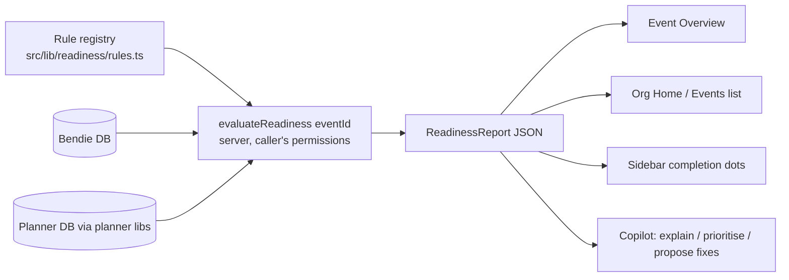

# 23 — Event Readiness Architecture

**Status:** PROPOSAL. It replaces nothing until approved. The existing logic was read in full first, as Portal 2.0 §14 requires.

## What exists today [V]

| Model | Where | Logic | Problems |
|---|---|---|---|
| **Event dashboard** | `dashboard/page.tsx` | **Required (2):** name + start date; ≥1 `event_members` row with role **exactly** `attendee`. **Recommended:** `hero`, `agenda`, `emergency` plus the sections chosen in Modules, each "has content" if its table has ≥1 row (count map lines 28–38). **Optional:** the rest. **Planner:** a fixed "next step" chain (participants → flights → hotels → transport → tasks → checklist → vendors → production) from `/planner-readiness`. | **B1:** the attendee count query is refused, so Required never passes in production (doc 15). "Has content" = 1 row, so 1 FAQ counts the same as 40. No quality checks: speakers without bios, sessions without speakers, overlaps. A staff-only event can never pass. |
| **Org "Setup progress %"** | `eventStats.ts` | 8 checks (description, location, hero image, theme colour, ≥1 speaker, session, emergency contact, FAQ) ÷ 8 | A different answer from the dashboard; ignores modules and Planner; percentage without meaning (Portal 2.0 §14 "avoid arbitrary percentages") |

## Proposal: one rule registry, computed on the server



- **One evaluator** serves the dashboard, org lists, sidebar dots and the Copilot. That removes the two diverging models.
- **Deterministic.** Rules are plain functions over data. The Copilot may *explain* and *propose fixes* but never decides readiness (§14).
- **Server-side.** It runs as the caller, so RLS-hidden data never counts. It reads Planner through the existing `src/lib/planner*.ts` modules (no new access logic). It replaces the scattered client `.count()` calls, and so removes B1's whole class of bug.

### Rule shape

```ts
type ReadinessRule = {
  id: string;                         // 'attendees.has_access'
  area: 'setup'|'programme'|'people'|'logistics'|'content';
  product: 'bendie'|'planner'|'both';
  appliesWhen: (ctx) => boolean;      // products, modules, event type
  severity: 'blocking'|'warning'|'recommended'|'optional';
  check: (data) => { status: 'done'|'issue'|'not_applicable'; count?: number; total?: number; records?: string[] };
  why: string;                        // one sentence, organiser language
  fix: { route: string; action?: string };   // from routes.json, never invented
  aiAssist?: 'draft'|'import'|'detect'|null; // what the Copilot can help with (pass 3)
};
```

### Severities (Portal 2.0 §14)

| Severity | Meaning | Effect |
|---|---|---|
| **Blocking** | Attendees can't use the event, or a Planner flow can't work | Shown first; prevents "Ready" |
| **Warning** | Works but will mislead or fail someone | Shown second |
| **Recommended** | Expected for this event's modules | "x of y" per area |
| **Optional** | Modules not chosen | Collapsed |
| **Done** | — | Tick, with the evidence count |

### Initial rules (each traced to verified behaviour)

| id | Severity | Check | Evidence |
|---|---|---|---|
| `event.basics` | Blocking | name, start, end, **timezone** set | Doc 11; 1 live event without a timezone |
| `attendees.has_access` | Blocking | ≥1 `event_members` row with **any** role that uses the app (not just `attendee`) **and** an active access code | Fixes the role-only check and B1 |
| `attendees.email` | Warning | Members without an email can't get a code | Doc 11 |
| `programme.sessions` | Recommended | ≥1 session | Today's check |
| `programme.overlaps` | Warning | Sessions overlapping in the same location; a speaker in two overlapping sessions | Doc 13 #6; 2 live overlaps |
| `programme.speakers_on_sessions` | Recommended | Sessions of type `session` with no speaker | B3 |
| `speakers.profiles` | Recommended | Speakers without bio or photo (a count, not pass/fail) | 58/136 without a bio live |
| `content.emergency` | Recommended | ≥1 emergency contact | Today's check |
| `content.<module>` | Recommended or Optional by Modules | ≥1 row | Today's count map |
| `networking.select_options` | Warning | Select questions without options | Feature 025 |
| `planner.provisioned` | Blocking (Planner) | provisioning `succeeded`; stale `pending` gives "Retry" | B4 |
| `planner.participants` → `flights` → `hotels` → `transport` | Recommended (Planner) | Coverage counts, e.g. "12 of 40 have no flight" | Today's chain, now counts not a chain |
| `planner.basics_drift` | Warning | Planner event name/dates differ from Bendie | Doc 09 (copied once) |
| `planner.identity_gaps` | Warning | Participants with no email (can't link to attendees or pull travel) | 86% live |
| `event.app_timezone` | Warning | `events.timezone` isn't `Africa/Nairobi`: the attendee app shows Nairobi times (until the app is fixed) | Doc 40 M1 |
| `visibility.public` | Info | Status `active`/`published` makes the event publicly readable | Doc 09 |

### Scoring: no single percentage

Each area shows **"Blocking n · Warnings n · Recommended x of y"**. The event headline is one of:
- **Not ready** (any blocking issue)
- **Ready with warnings**
- **Ready**

Org lists use the same headline and counts. If a percentage is ever needed, it's defined as *done recommended ÷ applicable recommended*, labelled as such, and never mixes in blocking items.

## User-facing answers (Portal 2.0 §14 questions)

| Question | Where it's answered |
|---|---|
| Is my event ready? | The headline on Overview and in event lists |
| What's missing? | Grouped issue list with counts and affected records (opens filtered lists) |
| Why does it matter? | `why` text on each rule |
| What should I do next? | "What's next": the first blocking issue, then the first warning, then the most valuable recommended item |
| Which can AI help with? | A ✦ marker on rules with `aiAssist` (pass 3) |
| What's stopping publishing? | Blocking rules (and, if a publish step is approved, its gate) |

## Migration

1. Fix B1 on `main` independently (developer decision pending).
2. Build `evaluateReadiness` behind the existing dashboard UI; compare old and new results on the test copy.
3. Switch org lists from `eventStats.ts` to the evaluator, then retire the 8-check %.
4. Add the quality rules in batches; each needs its own Spec Kit task with a test on the synthetic data (the seed already contains a missing bio, an overlap and an unassigned speaker).
