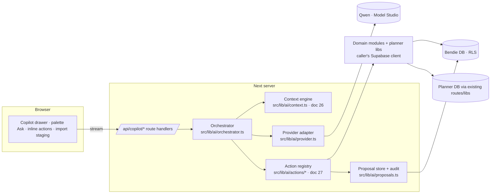

# 25 — AI Copilot Architecture

**Status:** PROPOSAL. Built on docs 04 (current architecture), 10 (permissions), 21 (domain modules, approved), 23 (readiness evaluator) and 24 (Qwen facts).

## Principles (Portal 2.0 §10–§16, and what the code shows)

1. **The AI never authorises.** Every tool runs through the caller's own Supabase client (RLS) or the existing server route guards. **There's no service-role client for AI.**
2. **No parallel business logic.** Tools call the shared domain modules (doc 21, Decision 1) and the existing `src/lib/planner*.ts` functions, never their own SQL.
3. **No raw SQL, shell or HTTP tools.** Only the typed actions listed in doc 27.
4. **Deterministic first.** Navigation, search, readiness, conflict checks and CSV parsing work without the model.
5. **Optional.** If Qwen is down or switched off, Studio is fully usable; AI entry points hide or explain.

## Components

| Component | Responsibility | Notes |
|---|---|---|
| **Provider adapter** | The only place that knows Qwen: model per tier, timeouts, retries, streaming, token accounting | `@ai-sdk/alibaba` (official), with `@ai-sdk/openai-compatible` as fallback. `server-only`. |
| **Orchestrator** | One request: build context → call model with allowed tools → validate each tool call → execute read tools / stage write tools → loop (max N) → stream | Hard limits (doc 34): max 6 tool rounds, 60s, token budget per request |
| **Context engine** | Decides what the model sees (doc 26) | Minimal, permission-filtered, PII-redacted |
| **Action registry** | Typed tools: zod input/output, permission check, risk level, executor | Doc 27, `data/ai-tools-proposal.json` |
| **Proposal store** | Write actions become **proposals** (diff + record versions), never direct writes | Approve, then revalidate, then execute through the domain module |
| **Audit** | Every tool call and proposal decision | Separate from the trigger-based content audit, which still records the actual writes |

## Request flow

`User request → context → Qwen (tools offered = those the user may use) → tool call → zod validation → permission check (as the user) → read tools execute | write tools → proposal → UI shows diff → user approves → revalidate permissions and record versions → domain module writes → trigger audit + AI audit → response`

## New storage (new tables in the Bendie DB; all RLS; designed in a later Spec Kit plan)

| Table | Purpose | Scope |
|---|---|---|
| `ai_conversations` | One per user × organisation × event (or org-level) | RLS: owner only |
| `ai_messages` | Turns; tool calls and results stored **redacted** | Retention: 30 days default, configurable |
| `ai_proposals` | Pending, approved, rejected or executed changes: entity, record ids, `updated_at` versions, diff, risk | Bound to user + org + event (§16) |
| `ai_action_log` | Tool name, args hash, result status, tokens, latency, model | Never stores raw contact or travel data |
| `ai_import_jobs` | Staged imports (doc 28) | Per event |

Feature flag: `organization_products`-style entitlement `ai` per organisation (doc 40 Q17), plus a global kill switch env var.

## Environment variables (names only)

`QWEN_API_KEY`, `QWEN_BASE_URL` (region endpoint, e.g. Frankfurt), `QWEN_MODEL_FAST`, `QWEN_MODEL_STANDARD`, `QWEN_MODEL_DEEP`, `QWEN_MODEL_VISION`, `AI_ENABLED` (kill switch). All are server-only and never prefixed `NEXT_PUBLIC_`.

## Failure behaviour

| Failure | Behaviour |
|---|---|
| Qwen timeout or 5xx | One retry (fast tier); then "Copilot is unavailable, everything else works" |
| Invalid tool args | One repair round with the validation error; then stop and show what was understood |
| Permission denied | Tell the user which role is needed; never retry with other means |
| Record changed since proposal | Proposal marked stale; re-propose |
| Model returns text instead of a tool (no `tool_choice: required`) | Treat as an answer; never parse actions out of prose |
