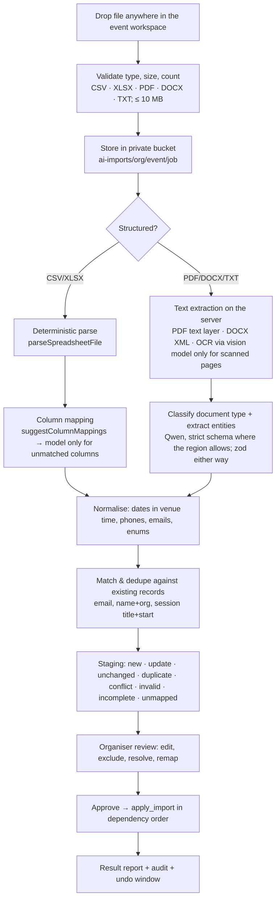

# 28 — Smart Ingestion Architecture

**Status:** PROPOSAL. It builds on what exists: `CsvImportModal`, `csvImport.ts` (`parseCsvFile`, `validateHeaders`, `parseFlexibleDate`…) and `spreadsheetImport.ts` (`parseSpreadsheetFile`, `suggestColumnMappings`, `applyColumnMappings`, `findDuplicateSources`). Those power 17 import screens today.

## Constraint from an existing spec

Feature 023 (FR-018) promises that spreadsheet import **runs in the browser and sends nothing over the network**. So:
- **Standard import stays exactly as it is:** deterministic, local, no AI.
- **AI-assisted import is a separate, opt-in path** ("Use Copilot to read this file"), with a one-line notice that the file's content is sent to the AI provider in region X. It's off when the organisation's `ai` entitlement is off.

## Pipeline (Portal 2.0 §12.2)

| Step | AI? | Rule |
|---|---|---|
| Parse CSV/XLSX | **No** | Existing parser; §12.2 "don't use an LLM for straightforward parsing" |
| Column mapping | Only for columns the deterministic matcher marks as low confidence | Samples sent are **redacted** (doc 26) |
| Document text | No (text layer); vision model only for scanned pages | — |
| Document → entities | **Yes** | Output validated by a zod schema per entity; every value keeps a **source reference** (page/line or sheet/row/cell) |
| Dedupe and match | No | Same keys the existing importers use (agenda: `sessionMatchKey(title, starts_at)`; people: lower-cased email) |
| Write | No (AI proposes, user approves) | Through the same per-entity save logic as manual import (domain modules, doc 21) |

## Multi-entity documents (§12.3)

A brief can yield event details, speakers, sessions, venues and sponsors. Staging groups them by entity and applies them **in dependency order** (doc 11): event fields → speakers → sessions → session speakers → breakouts. For Planner: participants → flights and hotels → movements → vehicles → assignments. Unsupported entities (e.g. a budget table) are listed as **"Not imported: Studio has no place for this"**, never silently dropped.

## Staging UI (§12.4)

- A table per entity, with a status column (New, Update, Unchanged, Duplicate, Conflict, Invalid, Incomplete).
- **Updates show "current → proposed"** per field.
- Row actions: edit value, exclude, merge with an existing record, change the mapping.
- "Download issues" (CSV of invalid and incomplete rows, built with the existing `downloadCsv`).
- A source preview pane highlights the page, row or cell that each value came from.
- Confidence badges **only** where measured. Deterministic matches are "Exact"; model output is "Check", with no invented percentages.

## Reliability (§12.5)

| Concern | Design |
|---|---|
| Large files | Job record `ai_import_jobs` + chunked extraction; progress in the UI; can be cancelled |
| Long jobs | Run in a server route with a time limit; beyond it, a queued job (Supabase Edge Function or cron worker) is a later decision |
| Idempotency | Job hash (file checksum + event) warns "This file was already imported on …" |
| Atomicity | Each entity batch is written in a transaction where the domain allows; Planner writes per record (separate database), with a per-row result |
| Partial failure | The result report lists written / failed rows; failed rows stay in staging to retry |
| Undo | For 24h: "Undo import" deletes records created by the job and restores updated fields from stored before-values (fails safe if a record changed since) |
| Retention | Uploaded files are deleted after 30 days or when the job is closed; extracted staging data follows `ai_messages` retention |
| Security | Files are untrusted (doc 32). Macros aren't executed; DOCX/XLSX are parsed as data; a size and page cap applies. |
