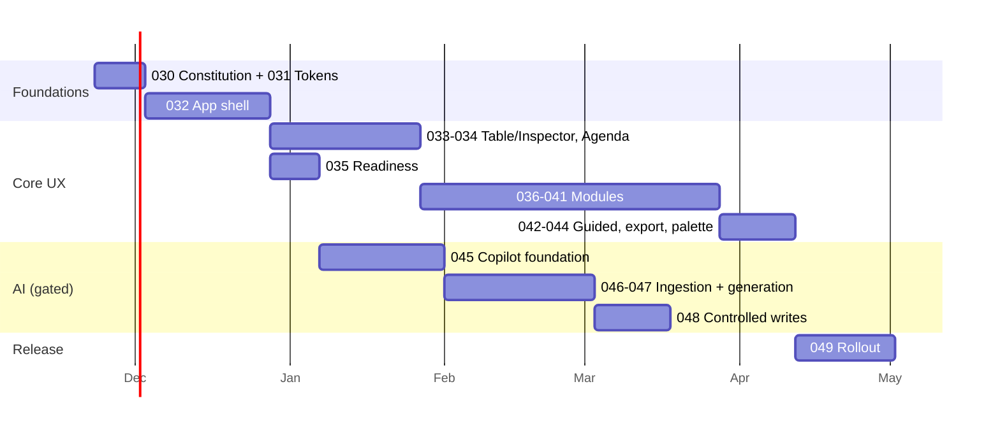

# 36 — Phased Implementation Roadmap

**Status:** PROPOSAL. Each phase becomes **its own Spec Kit feature** (`specs/030-…` onward), going through `/architect` → `/speckit.specify` → `clarify` → `plan` → `tasks` → `analyze` → `implement` → `/imprint` → `/review` → `/speckit.converge` (AGENTS.md). Nothing is built without that.

Complexity: S = days, M = 1–2 weeks, L = 3–5 weeks (one developer + Claude). These are estimates, not commitments.

## Phase 0: Discovery and stabilisation ✅ done

Docs 00–41, the test environment, the browser walk-through, and bugs B1–B5 fixed on `main` (`992e198`).

## Phase 1: Governance and foundations (030, 031)

| | |
|---|---|
| **030 Constitution v2.0.0** | Run `/speckit.constitution` to amend Principle II (allow domain modules in `src/lib/<domain>.ts`; allow the new event navigation), Principle V (inspector/sheet patterns; headless primitives Radix + TanStack + cmdk allowed; "no second **visual** design system" kept) and the stack (Next 15 / React 19). MAJOR bump; Sync Impact Report updates `code-standards.md`, `ui-rules.md`, `architecture.md`. |
| **031 Design tokens + focus + reduced motion** | Radius, elevation, status, product, density and motion tokens; `focus-ring`; `prefers-reduced-motion`. **No visual redesign yet.** |
| Dependencies | Approved decisions (docs 20, 21) |
| Risks | Token changes ripple visually → only add tokens; migrate usages page by page later |
| Complexity | S + S |
| Acceptance | Constitution v2.0.0 ratified; `tsc`/lint/build pass; no page looks different except focus rings |
| Rollback | Revert commits; tokens are additive |

## Phase 2: App shell (032)

| | |
|---|---|
| Objectives | New org and event shell: sidebar (6 areas, ≤2 levels), context strip (org, event, products, visibility, role), toolbar slot, one right panel slot, breadcrumbs. **Wraps existing pages without rewriting them.** |
| Scope | `src/components/shell/*`, the two layouts; routes unchanged (URLs stay `/portal/events/[id]/<section>`) |
| Flag | `studio_v2_shell` per user (cookie or profile setting) so both shells run side by side |
| Risks | `[eventId]/layout.tsx` is 1,098 lines of availability and capability logic → move it into a hook unchanged (`useEventSections`), and test against the walk-through |
| Complexity | L |
| Acceptance | Walk-through (doc 15) passes for all 3 roles with **identical access results**; parity rows for navigation filled in doc 16; axe has no new violations |
| Rollback | Turn the flag off |

## Phase 3: Data table + inspector pilot (033 Speakers, 034 Agenda)

| | |
|---|---|
| Objectives | Compound `DataTable` + `Inspector` + `DirtyGuard`; first domain modules (`speakers.ts`, `agenda.ts`); Agenda Timeline view + deterministic conflict checks (doc 30 validator) |
| Dependencies | Phases 1–2 |
| Risks | Agenda is 1,267 lines with breakouts → keep `save_breakout_rooms` / `choose_breakout_room` and the breakout modals as they are; migrate the list and editor only |
| Complexity | M + L |
| Acceptance | Every agenda/speaker capability in the parity matrix still works (CSV/XLSX import, breakouts, Planner push); `/imprint` records Table/Inspector |
| Rollback | Per-page flag falls back to the old page component |

## Phase 4: Readiness engine (035)

Server-side `evaluateReadiness` + rules (doc 23); Overview and org lists switch to it; the 8-check % retires. **M.** Acceptance: same or better results than today on the test copy; seeded issues (missing bio, overlap) detected.

## Phase 5: Module migration (036–041, one feature per area)

036 Setup (Event details + App appearance + Wording + Modules page + Visibility control) · 037 Content (News, FAQs, Info, Expo, Media, Engagement, Safety) · 038 People ("Everyone" read view + inspector tabs; Team & access page) · 039 Logistics (Travel per person, Ground transport board, Tasks/Vendors/Checklist tables) · 040 Run of show (Planner agenda + Production timeline) · 041 Org workspace (Home, Events, People+Teams, Library, Activity). **M each.** Same acceptance and rollback pattern as Phase 3.

## Phase 6: Guided build, create sheet, export, palette (042–044)

Guided-build rail (doc 19), 3-field create sheet with Retry for stale provisioning, CSV/XLSX export, ⌘K palette (deterministic). **M.**

## Phase 7: Copilot foundation (045). **Built as a working prototype first; legal gate only before real data.**

Developer direction (2026-11-20): the concept must be approved as a **working solution** before the data-protection questions are raised. So Phase 7 runs in two steps:
1. **Prototype:** built and demonstrated on the **test environment with synthetic data only**. It uses a developer-owned Model Studio key; Singapore's free quota is enough. No real organisation has AI enabled. The design already validates every model output, so the lack of strict JSON Schema in Singapore doesn't matter here.
2. **Production enablement:** only after concept approval **and** the doc 32 decisions (region, DPA, transfer review). Then AI is switched on per organisation.

Provider adapter (`@ai-sdk/alibaba`), orchestrator, context engine, **read and draft tools only**, drawer UI, `ai_*` tables with RLS, per-organisation entitlement (off by default), kill switch, eval harness. **L.** Acceptance: doc 24 pass bars on synthetic data; adversarial suite 0% injection-following; Studio fully usable with AI off.

## Phase 8: Smart ingestion and generation (046, 047)

AI-assisted import as an opt-in path beside the unchanged local import (doc 28); event builder (doc 29); agenda and run-of-show drafts (doc 30). **L.**

## Phase 9: Controlled AI writes (048)

Proposal store, diff and approval UI, write and high-impact tools (doc 27), Undo, audit. **M.** Acceptance: stale-proposal, permission-revocation and typed-confirmation tests pass.

## Phase 10: Rollout (049)

Pilot organisation (Studio Test Org, then one friendly client), flags on per organisation; measure doc 38 metrics; retire old shell and pages once parity is signed off. **M.**

## Sequence

Dates are illustrative, assuming a start on 2026-11-23. Phase 7's prototype step can run in parallel with Phase 5. It needs no legal gate because it only touches synthetic test data.
